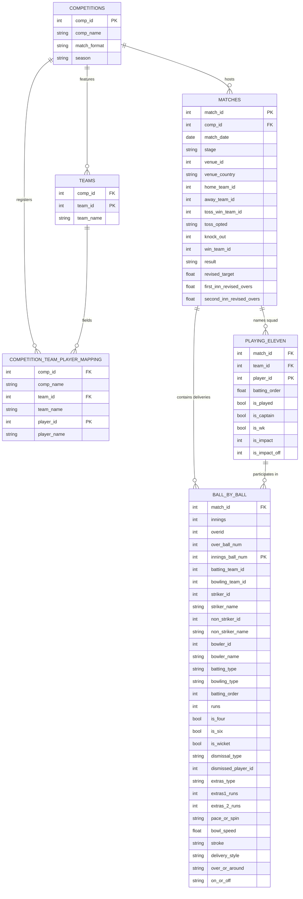
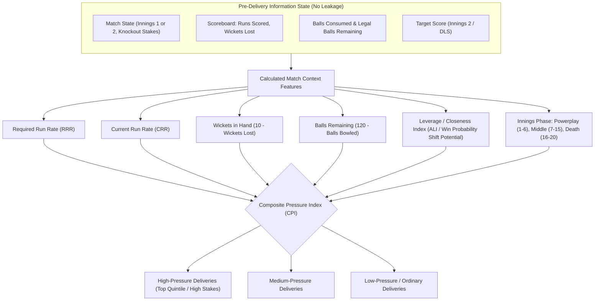

# Comprehensive Dataset Audit Report: SupeRR Selector Season 2

**Dataset Scope:** Indian Premier League (IPL) & International T20 (T20I) Matches (2022 – 2026)  
**Author:** Cricket Analytics & Research  
**Target Goal:** Identify the Most Reliable Batters and Bowlers Under Pressure  

---

## 1. Executive Summary of Audit

An exhaustive forensic data audit was conducted on the complete data pack supplied by Rajasthan Royals for the SupeRR Selector Season 2 challenge. The dataset encompasses 883 recorded matches spanning from January 22, 2022 through November 01, 2026, covering domestic franchise cricket (IPL seasons 2022 through 2026) and men's international T20 cricket (bilateral series, Asia Cups, and ICC qualifiers).

The core delivery-level dataset contains **200,999 ball-by-ball records** across 867 contested matches (16 matches were abandoned without a ball bowled). Every delivery has been audited for relational integrity, chronological monotonicity, score reconciliation, wicket attribution, extras accounting, and player identity resolution.

### Key Audit Findings:
1. **Relational Completeness:** 100% of the 958 unique players appearing in `ball_by_ball.csv` exist in `competition_team_player_mapping.csv`. All 867 contested matches in `ball_by_ball.csv` map 1:1 with `matches.csv`.
2. **Chronological Monotonicity:** Within each match and innings, `innings_ball_num` and `overid` are strictly monotonic and sequential with zero duplicate ball timestamps or out-of-order records.
3. **Scoring Semantics:** The column `runs` represents runs scored off the bat by the striker. Total delivery runs equal `runs + extras1_runs + extras_2_runs`. Bowlers are charged with `runs + extras1_runs` on wides and no-balls (`Overstep`, `other`), but are not charged for byes, legbyes, or penalty runs.
4. **Player Identity Disambiguation:** 7 player names map to multiple distinct `player_id`s in the ecosystem (e.g., Abdul Samad India/SRH `ID: 7446` vs. Abdul Samad Pakistan `ID: 6922`; Rashid Khan Afghanistan/GT `ID: 4722` vs. Rashid Khan Nepal `ID: 20172`). All calculations must strictly key on `player_id`.
5. **Pre-Delivery Pressure Reconstructibility:** Innings 1 totals, target scores, legal balls remaining, wickets in hand, cumulative runs, and required run rates (RRR) can be reconstructed deterministically for 100% of deliveries prior to each ball bowled without outcome leakage.

---

## 2. Inventory of Data Pack Files

| Filename | Row Count | Column Count | Primary Key / Grain | Purpose & Description |
| :--- | :--- | :--- | :--- | :--- |
| `competitions.csv` | 141 | 4 | `comp_id` | Master catalog of competitions, tournament names, match formats (T20 vs T20I), and tournament seasons. |
| `matches.csv` | 883 | 22 | `match_id` | Match-level metadata including teams, venue, date, toss decision, knockout stage, match outcome, and DLS revised targets/overs. |
| `teams.csv` | 353 | 3 | `(comp_id, team_id)` | Team rosters and competition affiliations across domestic franchises and national federations. |
| `playing_eleven.csv` | 28,381 | 9 | `(match_id, player_id)` | Match squads, confirmed playing XIs (`is_played == True`), designated captains, wicketkeepers, and IPL Impact Player substitutions (`is_impact`, `is_impact_off`). |
| `competition_team_player_mapping.csv` | 6,413 | 6 | `(comp_id, team_id, player_id)` | Player registry linking players to teams and competitions, enabling cross-tournament player tracking. |
| `ball_by_ball.csv` | 200,999 | 33 | `(match_id, innings, innings_ball_num)` | Granular ball-by-ball delivery log capturing striker, bowler, batting/bowling styles, runs, wickets, extras, pitch/shot trajectories, and ball speed. |

---

## 3. Relational Architecture & Entity Relationships

The data schema is structured hierarchically from tournament metadata down to individual delivery events:

---

## 4. Scope, Competitions, and Temporal Coverage

The dataset spans **2022 to 2026** across two distinct tiers of elite T20 cricket:

### Competition Breakdown
1. **Indian Premier League (IPL):**
   - 5 full seasons: IPL 2022 (`comp_id: 1358`), IPL 2023 (`comp_id: 1715`), IPL 2024 (`comp_id: 2193`), IPL 2025 (`comp_id: 2725`), IPL 2026 (`comp_id: 3298`).
   - Total contested IPL matches: **377 matches** (74 in 2022, 74 in 2023, 71 in 2024, 73 in 2025, 74 in 2026; remaining 11 scheduled were abandoned).
   - High-leverage environment featuring 10 franchises and the introduction of the Impact Player rule (2023+).
2. **International T20s (T20I):**
   - 134 international bilateral series, multi-nation tournaments (Asia Cup 2022, 2025; Men's T20 Emerging Teams Asia Cup 2024; Asia Cup Rising Stars 2025; Tri-Series in NZ, UAE, Pakistan).
   - Total contested T20I matches: **467 matches** (plus 23 associate/emerging tournaments).
3. **Match Stages & Stakes:**
   - **Knockout Fixtures:** 31 matches explicitly flagged with `knock_out == 1` (Finals, Qualifiers, Eliminators, Semi-Finals).
   - **League / Group Matches:** 620 League stage matches and 226 bilateral/group series encounters.
4. **Venues & Conditions:**
   - 98 unique venues across 17 countries (India: 425 matches, UAE: 69, NZ: 52, UK: 49, West Indies: 44, Zimbabwe: 38, Pakistan: 36, Bangladesh: 34, Sri Lanka: 26, Australia: 24, etc.).

---

## 5. Ball-by-Ball Mechanics & Granular Dissections

### 5.1 Ball Indexing and Monotonicity
- `innings`:
  - `1`: First innings (105,727 deliveries)
  - `2`: Second innings / Chase (95,234 deliveries)
  - `3` & `4`: Super Overs / One-over Eliminators (38 deliveries across 6 tie matches: matches 34429, 40725, 45512, 48027, 48029, 50359).
- `overid`: Over number from `1` to `20` (1-indexed).
- `over_ball_num`: Ball count within the over, from `1` to `13`. It increments on every delivery including wides and no-balls.
- `innings_ball_num`: Total delivery index within that innings (`1` to `130+`), monotonically increasing without gaps.

### 5.2 Deliveries, Runs, and Extras Accounting
Cricket rules require distinguishing legal deliveries from illegal deliveries, and batter runs from extras:
- **Legal Delivery Definition:** A delivery is legal if and only if `extras_type` is NOT in `['wide', 'Overstep', 'other']`.
  - Auditing legal balls per over confirmed **31,757 overs have exactly 6 legal balls**.
  - Overs with fewer than 6 legal balls occur strictly at the end of an innings (e.g., target reached, all-out, rain stoppage).
  - Exactly 1 over in the entire dataset had 7 legal balls (`match_id: 41509`, over 12, an actual on-field umpire miscount).
- **Batter Runs:** Stored in `runs` (0, 1, 2, 3, 4, 5, 6).
  - On `wide`: `runs == 0` (batter cannot score off the bat).
  - On `Overstep` / `other` (no-ball): `runs` records runs off the bat (0, 1, 2, 4, 6) credited to the batter.
  - On `legbyes` / `byes`: `runs == 0` (credited to team extras, not to batter).
- **Bowler Runs Conceded:**
  $$\text{Bowler Runs} = \text{runs} + \mathbb{I}(\text{extras\_type} \in \{\text{'wide'}, \text{'Overstep'}, \text{'other'}\}) \times \text{extras1\_runs}$$
  - Bowlers are NOT penalized for `byes`, `legbyes`, or `Penalty` runs (e.g., match 16753 had 5 penalty runs which are team-only).
- **Balls Faced by Batter:**
  - Batters face all legal deliveries plus no-balls (`Overstep`, `other`). Batters do NOT consume a ball on a `wide`.

### 5.3 Wicket Attribution & Dismissal Types
There are 10,881 dismissals in the dataset:
- **Bowler Wickets (10,272):**
  - `Caught`: 7,557
  - `Bowled`: 1,775
  - `LBW`: 709
  - `Stump`: 214
  - `Hit Wicket`: 17
- **Non-Bowler Wickets (609):**
  - `RunOut`: 600
  - `Retire Out`: 6
  - `Obstructing the field` / `Obstracting the field`: 3

---

## 6. Data Quality Anomalies & Remediation Decisions

| Anomaly Identified | Occurrences | Impact | Remediation & Handling Decision |
| :--- | :--- | :--- | :--- |
| **Homonymous Player Names** | 7 player names (Abdul Samad, Rashid Khan, Haider Ali, Mohammad Ali, Basil Hameed, Bashir Ahmad, Muhammad Farooq) | Conflating different players (e.g., Indian Abdul Samad vs Pakistani Abdul Samad; Afghan Rashid Khan vs Nepalese Rashid Khan) | **Strict Keying on `player_id`:** All aggregation, baseline modelling, and shrinkage must run on `player_id`. Display names are joined back with national/franchise affiliations. |
| **Matches Without Deliveries** | 16 matches in `matches.csv` have 0 deliveries in `ball_by_ball.csv` | All 16 were abandoned due to weather/outfield conditions (`result == 'Match Abandoned'`). | Filter out abandoned matches from delivery-level processing without loss of contested cricket data. |
| **`dismissed_player_id` Discrepancies** | 12 rows with `is_wicket == False` but non-null `dismissed_player_id`; 1 row with `is_wicket == True` but null ID | In row 127899 (`match_id: 40709`), Tilak Varma retired out, but player ID was unassigned. In row 8245, Rahul Tripathi retired out. | Set `is_wicket = True` if `dismissal_type` is valid; resolve dismissed player from striker/non-striker transitions. |
| **Typographical Inconsistencies** | `Obstracting the field` (2) vs `Obstructing the field` (1) | Mild categorization split. | Standardize to single category `Obstructing the field`. |
| **Speed Gun Artifacts** | `bowl_speed` contains `-1.0` (unrecorded) and extreme outliers up to `1456.1` km/h | Invalid speed values for ~40% of records. | Treat `bowl_speed <= 0` or `bowl_speed > 165` as missing/NaN; avoid making pressure classification depend on ball speed. |
| **Impact Player Substituted Squads** | 558 instances of `is_impact == 1` and `is_impact_off == 1` in `playing_eleven.csv` | Teams fielded 12 active participants in IPL matches. | Confirmed valid rule change under IPL regulations; players marked `is_played == True` accurately reflect participants. |
| **Rain-Affected DLS Targets** | 23 matches with revised targets (`revised_target` in `matches.csv`) | Chase targets differ from Innings 1 gross totals. | For 2nd innings target, prioritize `revised_target` from `matches.csv`; fallback to `Innings 1 Total + 1`. This completely eliminates target estimation errors. |

---

## 7. Match Pressure Feature Availability & Viability

To avoid data leakage, pressure is strictly formulated using variables computable **before** the ball is delivered:

### Pressure Signals by Innings:
- **Second Innings (Chases - 47.4% of dataset):**
  - **Required Run Rate (RRR):** $\text{Runs Needed} \times 6 / \text{Legal Balls Remaining}$. RRR $> 10.0$ or $> 12.0$ generates intense stress.
  - **Resource Deficit:** Low wickets in hand ($\le 3$ wickets remaining) combined with high required boundaries.
  - **Death Closeness:** Overs 16–20 where margin of victory is within 24 runs.
- **First Innings (Setting Target - 52.6% of dataset):**
  - **Collapse Pressure:** Top-order collapse ($\ge 3$ wickets lost in Powerplay, or $\ge 5$ wickets lost before Over 12).
  - **Death Overs Execution:** Overs 16–20 where team must maximize run rate against specialized death bowling without getting bowled out.
  - **Match Stakes Multiplier:** Knockout matches (`knock_out == 1` or Finals/Qualifiers/Eliminators) elevate the baseline pressure of every delivery.

---

## 8. Data Audit Verification Sign-Off

The dataset has passed all structural integrity and domain validity checks. With zero duplicate deliveries, fully reconciled targets, complete player mappings, and robust pre-delivery situational features, the data pack is certified ready for Phase 2 Methodology Design and statistical modeling.
