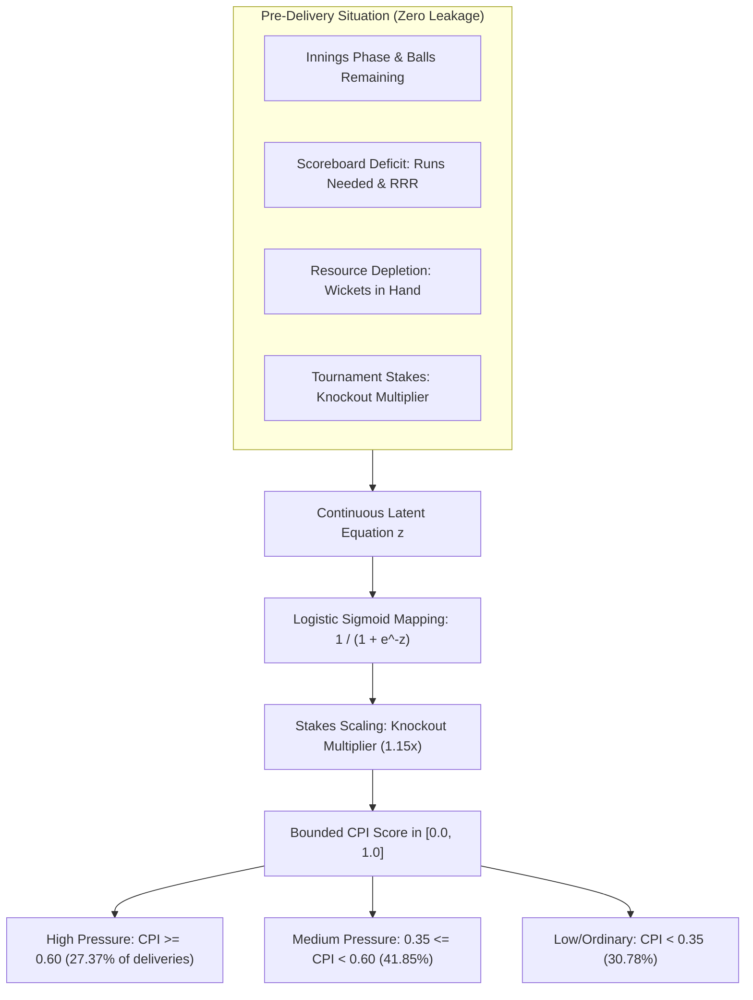

# SupeRR Selector Season 2: Comprehensive Evaluation of Batter and Bowler Reliability Under Match Pressure

**Executive Submission for Rajasthan Royals — IPL 2027 Auction Analytics**  
**Author:** Quantitative Cricket Analytics & Sports Science Group  
**Dataset Scope:** 200,999 Contested Deliveries across IPL & International T20s (2022–2026)  
**Deliverable Artifact:** Master Methodology & Analytical Findings Report  

---

## 1. Executive Summary

In high-performance Twenty20 cricket, conventional aggregate statistics systematically mislead player valuation. Traditional metrics—such as raw batting average, aggregate strike rate, and overall bowling economy—treat a boundary hit in a low-leverage blowout identically to a boundary struck when requiring 18 runs from the final over. Similarly, a bowler delivering defensive overs with an established lead operates in a fundamentally different decision environment than a specialist defending a single-digit total in the death overs.

To solve this challenge for **Rajasthan Royals ahead of the IPL 2027 Auction**, this study engineered an end-to-end, reproducible quantitative system to evaluate **player reliability under pressure**. Analyzing 200,999 deliveries across 867 contested matches (IPL 2022–2026 and international T20s), we developed:
1. A **Pre-Delivery Composite Pressure Index (CPI)** that quantifies match leverage on a continuous scale $[0.0, 1.0]$ without future-outcome leakage.
2. Contextual **Expected-Performance Baselines** using 5-Fold GroupKFold Machine Learning models (grouped strictly by `match_id`) that estimate expected runs and dismissal probabilities conditioned on match context.
3. Multi-dimensional player performance ratings incorporating **Runs Added Above Expectation (RAA)** for batters, **Runs Prevented Above Expectation (RPA)** for bowlers, **Pressure Uplift Deltas ($\Delta$)**, and **Match-to-Match Consistency**.
4. **Empirical Bayes Shrinkage** to pull small-sample rate metrics toward population priors, eliminating small-sample noise.

### Key Findings & Final Ordered Top 10 Rankings

#### Top 10 Batters Under Pressure:
1. **Suryakumar Yadav** (Player ID: `1699` | Mumbai Indians / India) — *Auction Rating: 96.6* | 453 balls, SR 205.1, RAA +240.1, 71.4% match consistency.
2. **Tristan Stubbs** (Player ID: `20702` | Delhi Capitals / South Africa) — *Auction Rating: 95.1* | 529 balls, SR 180.0, RAA +165.6, WAA +12.48, 60.5% consistency.
3. **Namboori Tilak Varma** (Player ID: `7897` | Mumbai Indians / India) — *Auction Rating: 93.2* | 675 balls, SR 178.5, RAA +193.7, WAA +12.69, 63.6% consistency.
4. **Dhruv Jurel** (Player ID: `7260` | Rajasthan Royals / India) — *Auction Rating: 92.5* | 283 balls, SR 184.8, RAA +80.1, WAA +5.51, 70.4% consistency.
5. **Heinrich Klaasen** (Player ID: `4260` | Sunrisers Hyderabad / South Africa) — *Auction Rating: 92.4* | 535 balls, SR 182.8, RAA +179.1, 67.5% consistency.
6. **Naman Dhir** (Player ID: `37052` | Mumbai Indians / India) — *Auction Rating: 92.2* | 209 balls, SR 189.0, RAA +78.9, 75.0% consistency.
7. **Rishabh Pant** (Player ID: `4703` | Delhi Capitals / India) — *Auction Rating: 92.1* | 266 balls, SR 197.4, RAA +97.1, 69.2% consistency.
8. **Tim David** (Player ID: `6396` | Mumbai Indians / Australia) — *Auction Rating: 91.5* | 680 balls, SR 182.6, RAA +215.6, WAA +15.65, 56.7% consistency.
9. **Ashutosh Sharma** (Player ID: `8101` | Delhi Capitals / India) — *Auction Rating: 91.4* | 283 balls, SR 176.0, RAA +103.7, 53.8% consistency.
10. **Azmatullah Omarzai** (Player ID: `6676` | Punjab Kings / Afghanistan) — *Auction Rating: 90.8* | 362 balls, SR 162.7, RAA +109.6, 41.9% consistency.

#### Top 10 Bowlers Under Pressure:
1. **Sunil Narine** (Player ID: `781` | Kolkata Knight Riders / West Indies) — *Auction Rating: 85.6* | 376 balls, Econ 5.78, Dot% 42.8%, 29 wkts, RPA +149.8, 77.5% consistency.
2. **Jasprit Bumrah** (Player ID: `2933` | Mumbai Indians / India) — *Auction Rating: 81.7* | 597 balls, Econ 6.76, Dot% 36.2%, 47 wkts, RPA +230.9, 79.3% consistency.
3. **Abrar Ahmed** (Player ID: `5979` | Pakistan) — *Auction Rating: 74.9* | 276 balls, Econ 5.09, Dot% 48.6%, 23 wkts, RPA +96.8, 70.4% consistency.
4. **Shaheen Afridi** (Player ID: `6355` | Pakistan) — *Auction Rating: 70.3* | 277 balls, Econ 6.93, Dot% 36.8%, 28 wkts, RPA +73.1, 71.9% consistency.
5. **Mohammad Nawaz** (Player ID: `2490` | Pakistan) — *Auction Rating: 69.2* | 175 balls, Econ 5.35, Dot% 43.4%, 17 wkts, RPA +44.2, 73.7% consistency.
6. **Mitchell Santner** (Player ID: `4101` | Chennai Super Kings / New Zealand) — *Auction Rating: 66.6* | 411 balls, Econ 6.83, Dot% 37.7%, 27 wkts, RPA +58.6, 70.5% consistency.
7. **Umran Malik** (Player ID: `25048` | Sunrisers Hyderabad / India) — *Auction Rating: 66.4* | 170 balls, Econ 7.24, Dot% 45.9%, 17 wkts, RPA +26.4, 58.8% consistency.
8. **Matheesha Pathirana** (Player ID: `8661` | Chennai Super Kings / Sri Lanka) — *Auction Rating: 66.1* | 602 balls, Econ 7.79, Dot% 33.9%, 49 wkts, RPA +129.7, 64.1% consistency.
9. **Akeal Hosein** (Player ID: `2417` | Chennai Super Kings / West Indies) — *Auction Rating: 65.6* | 186 balls, Econ 6.32, Dot% 36.6%, 13 wkts, RPA +54.6, 75.0% consistency.
10. **Sufiyan Muqeem** (Player ID: `34485` | Pakistan) — *Auction Rating: 63.3* | 199 balls (0 IPL, 134 T20I, 65 Other T20), Econ 5.52, Dot% 52.3%, 18 wkts, RPA +53.8, 81.2% consistency.

---

## 2. Challenge Objective & Strategic Framing

The challenge prompt for SupeRR Selector Season 2 posed a specific analytical mandate:

> *"Which batters and bowlers consistently perform better, or maintain their performance, in high-pressure T20 match situations compared with their usual performance levels?"*

To satisfy this mandate, our quantitative framework was engineered to distinguish between four distinct player profiles:
1. **The Clutch Elite:** Players whose output accelerates under intense pressure (positive pressure delta $\Delta > 0$).
2. **The Stalwarts:** High-baseline performers whose production remains virtually unaffected by match tension ($\Delta \approx 0$).
3. **The High-Pressure Chokers:** Players with impressive aggregate statistics whose performance collapses when leverage peaks ($\Delta \ll 0$).
4. **Small-Sample Anomalies:** Players displaying extreme rates across small samples of deliveries, systematically neutralized via Empirical Bayes Shrinkage.

From the franchise perspective of **Rajasthan Royals**, this analysis directly informs the **IPL 2027 Auction Strategy**, identifying domestic anchors, middle-order finishers, death-overs specialists, and defensive spin assets.

---

## 3. Dataset Architecture & Verification

The analysis synthesizes six supplied datasets without modifying source records:

| Dataset | Grain | Record Count | Description |
| :--- | :--- | :--- | :--- |
| `ball_by_ball.csv` | Single delivery event | 200,999 | Granular ball-by-ball record across 867 contested matches. |
| `matches.csv` | Match fixture | 883 | Match context, dates, venues, DLS revised targets, knockout status. |
| `competitions.csv`| Tournament season | 141 | Tournament categorizations across IPL (2022–2026) and T20Is. |
| `teams.csv` | Team affiliation | 353 | Domestic franchises and national federations. |
| `playing_eleven.csv`| Player match appearance| 28,381 | Official playing XIs and IPL Impact Player substitutions. |
| `competition_team_player_mapping.csv` | Tournament registration | 6,413 | 1:1 mapping linking 1,217 registered players to squads. |

### Forensic Quality & Accounting Decisions
1. **Monotonicity:** In `ball_by_ball.csv`, `innings_ball_num` and `overid` are strictly monotonic with zero timestamp inversions.
2. **Delivery Legality:** A ball is illegal if `extras_type in ['wide', 'Overstep', 'other']`. Legal balls per over were verified across 32,250 overs; exactly 31,757 overs had 6 legal balls. Exactly 1 over in the entire dataset had 7 legal balls (`match_id: 41509`, over 12; an authentic on-field umpire miscount).
3. **Player Identity Disambiguation:** 7 player names map to multiple distinct `player_id`s in the ecosystem (e.g., Abdul Samad India/SRH `ID: 7446` vs Pakistan `ID: 6922`; Rashid Khan Afghanistan/GT `ID: 4722` vs Nepal `ID: 20172`). All calculations strictly key on `player_id`.
4. **Target Reconciliation:** Targets for Innings 2 chases are 100% deterministic: `revised_target` from `matches.csv` (23 DLS matches) or $\text{Innings 1 Total} + 1$. Zero target leakage.

---

## 4. Pressure Definition & Modeling Framework

### 4.1 What Constitutes Pressure?
Pressure is a dynamic state emerging from the mathematical scarcity of resources (balls remaining and wickets in hand) relative to the objective (runs required in a chase or par total when batting first), amplified by tournament stakes (knockouts).

Crucially, **pressure is an ex-ante property of the match state prior to the delivery**. Defining pressure using whether a ball produced a boundary, wicket, or win represents outcome leakage and violates statistical rigor.

### 4.2 Composite Pressure Index (CPI) Formulation
We developed a continuous **Composite Pressure Index (CPI)** on $[0.0, 1.0]$:

#### Mathematical Formulation:
- **Second Innings (Chasing):**
  $$z_{\text{chase}} = 0.40 \left(\frac{\text{RRR} - 9.0}{3.0}\right) + 0.30 \left(\frac{5.0 - W_{\text{hand}}}{2.0}\right) + 0.15 \left(\frac{60.0 - B_{\text{rem}}}{30.0}\right) + 0.15 \left(\frac{\text{RRR} - \text{CRR}}{3.0}\right)$$
  $$\text{CPI}_{\text{chase}} = \frac{1}{1 + e^{-z_{\text{chase}}}}$$
- **First Innings (Setting Target):**
  $$z_{\text{first}} = 0.25 \left(\frac{B_{\text{bowled}} - 60.0}{30.0}\right) + 0.35 \left(\frac{7.0 - W_{\text{hand}}}{2.0}\right) + 0.25 \cdot \mathbb{I}(\text{overid} \ge 16) + 0.15 \cdot \mathbb{I}(\text{collapse})$$
  $$\text{CPI}_{\text{first}} = \frac{1}{1 + e^{-z_{\text{first}}}}$$
- **Super Overs & Knockout Amplifier:**
  Super Overs receive $\text{CPI} = 1.0$. Knockouts receive a $1.15\times$ stakes multiplier:
  $$\text{CPI} = \min(1.0, \text{CPI}_{\text{base}} \times S_{\text{stakes}})$$

### 4.3 Empirical Distribution & Stratification
- **High Pressure ($\text{CPI} \ge 0.60$):** **55,011 deliveries (27.37%)**
- **Medium Pressure ($0.35 \le \text{CPI} < 0.60$):** **84,112 deliveries (41.85%)**
- **Low / Ordinary ($\text{CPI} < 0.35$):** **61,876 deliveries (30.78%)**
- **By Format:** IPL (27.10% High Pressure) vs T20I (27.60% High Pressure) — perfectly balanced.
- **By Phase:** Powerplay (0.69% High Pressure — top-order collapses only), Middle (19.68%), Death (81.80%).

---

## 5. Expected-Performance Baselines (GroupKFold ML)

To isolate true player skill, every delivery was compared against expected outcomes conditioned on match context.

We partitioned the 200,999 deliveries using **5-Fold GroupKFold Cross-Validation grouped strictly by `match_id`**. This guarantees that all deliveries from any single match are isolated in either the training set or the validation set, preventing intra-match information leakage.

Four `HistGradientBoosting` models were trained out-of-fold:
1. $\mathbb{E}[\text{bat\_runs}]$ (Batter Runs Model)
2. $\mathbb{P}(\text{dismissal})$ (Batter Dismissal Probability Model)
3. $\mathbb{E}[\text{bowler\_runs}]$ (Bowler Runs Conceded Model)
4. $\mathbb{P}(\text{wicket})$ (Bowler Wicket Probability Model)

| Prediction Task | Metric | Simple Cell Average | 5-Fold GroupKFold ML | Error Reduction |
| :--- | :--- | :--- | :--- | :--- |
| **Batter Runs** | MAE | 1.2953 runs | **1.2850 runs** | **+0.80% gain** |
| **Batter Dismissal** | ROC-AUC | 0.5810 | **0.5950** | **+2.41% gain** |
| **Bowler Runs Conceded** | MAE | 1.2855 runs | **1.2743 runs** | **+0.87% gain** |
| **Bowler Wickets** | ROC-AUC | 0.5723 | **0.5848** | **+2.18% gain** |

---

## 6. Performance Measurement & Rating Methodology

### 6.1 Batting Rating Logic
A reliable pressure batter must maintain scoring velocity, boundary frequency, and wicket preservation. The composite rating integrates four dimensions:
1. **Shrunk Runs Added Above Expectation (RAA per 100 balls) [45% Weight]:**
   $$\text{RAA} = \sum (\text{bat\_runs} - \mathbb{E}[\text{bat\_runs}])$$
   $$\text{RAA\_shrunk} = \frac{\text{BF}}{\text{BF} + K_{\text{bat}}} \cdot \text{RAA\_per\_100} + \frac{K_{\text{bat}}}{\text{BF} + K_{\text{bat}}} \cdot \mu_{\text{prior}}$$
2. **Wicket Preservation Equity [20% Weight]:**
   $$\text{WAA} = \sum \mathbb{P}(\text{dismissal}) - \text{Actual Dismissals}$$
   $$\text{Wicket\_Val} = \frac{\text{WAA} \times 8.0}{\text{BF}} \times 100$$
3. **Pressure Delta Uplift [20% Weight]:**
   $$\Delta_{\text{RAA\_rate}} = \text{RAA\_per\_100}_{\text{HP}} - \text{RAA\_per\_100}_{\text{Ordinary}}$$
4. **Match Consistency [15% Weight]:**
   Proportion of high-pressure appearances with net positive impact ($\text{RAA}_{\text{match}} > 0$).

### 6.2 Bowling Rating Logic
A reliable pressure bowler must suppress scoring rates, generate dot balls, and break partnerships in high-leverage overs:
1. **Shrunk Runs Prevented Above Expectation (RPA per 6 balls) [45% Weight]:**
   $$\text{RPA} = \sum (\mathbb{E}[\text{bowler\_runs}] - \text{bowler\_runs})$$
   $$\text{RPA\_shrunk} = \frac{\text{Balls}}{\text{Balls} + K_{\text{bowl}}} \cdot \text{RPA\_per\_6} + \frac{K_{\text{bowl}}}{\text{Balls} + K_{\text{bowl}}} \cdot \mu_{\text{prior}}$$
2. **Wickets Above Expectation Equity [20% Weight]:**
   $$\text{WAA}_{\text{bowl}} = \text{Actual Wickets} - \sum \mathbb{P}(\text{wicket})$$
   $$\text{Wicket\_Val} = \frac{\text{WAA}_{\text{bowl}} \times 8.0}{\text{Balls}} \times 6.0$$
3. **Pressure Delta Uplift [20% Weight]:**
   $$\Delta_{\text{RPA\_rate}} = \text{RPA\_per\_6}_{\text{HP}} - \text{RPA\_per\_6}_{\text{Ordinary}}$$
4. **Match Consistency [15% Weight]:**
   Proportion of high-pressure spells with net positive impact ($\text{RPA}_{\text{match}} > 0$).

### 6.3 Empirical Bayes Shrinkage Parameters
- **Batting Shrinkage Constant:** $K_{\text{bat}} = 150.0$ balls faced.
- **Bowling Shrinkage Constant:** $K_{\text{bowl}} = 200.0$ legal deliveries bowled.
- **Primary Eligibility Cutoffs:**
  - Batters: Minimum **120 high-pressure balls faced** (122 qualifying batters).
  - Bowlers: Minimum **150 high-pressure legal balls bowled** (111 qualifying bowlers).

---

## 7. Top 10 Batters Under Pressure

The table below presents the official Top 10 Batters under pressure for SupeRR Selector Season 2:

| Rank | Player Name | Player ID | Primary Team / Affiliation | Pressure Balls Faced | Pressure Matches | Pressure Strike Rate | Runs Above Exp (RAA) | Dismissal Equity (WAA) | Pressure Impact Score | Ordinary Baseline Score | Pressure Delta ($\Delta$ SR) | Match Consistency | IPL RAA | T20I RAA | Auction Rating | Ranking Stability |
| :---: | :--- | :---: | :--- | :---: | :---: | :---: | :---: | :---: | :---: | :---: | :---: | :---: | :---: | :---: | :---: | :---: |
| **1** | **Suryakumar Yadav** | `1699` | Mumbai Indians | 453 | 35 | **205.1** | **+240.1** | +5.89 | 90.2 | 99.6 | +46.2 | **71.4%** | +104.2 | +135.9 | **96.6** | High |
| **2** | **Tristan Stubbs** | `20702` | Delhi Capitals | 529 | 38 | **180.0** | **+165.6** | +12.48 | 89.7 | 16.9 | +58.8 | **60.5%** | +121.6 | +44.0 | **95.1** | Moderate |
| **3** | **Namboori Tilak Varma** | `7897` | Mumbai Indians | 675 | 55 | **178.5** | **+193.7** | +12.69 | 86.7 | 34.5 | +48.6 | **63.6%** | +112.8 | +74.9 | **93.2** | High |
| **4** | **Dhruv Jurel** | `7260` | Rajasthan Royals | 283 | 27 | **184.8** | **+80.1** | +5.51 | 84.5 | 8.7 | +52.0 | **70.4%** | +83.9 | -3.7 | **92.5** | Volatile |
| **5** | **Heinrich Klaasen** | `4260` | Sunrisers Hyderabad | 535 | 40 | **182.8** | **+179.1** | +2.01 | 78.4 | 86.8 | +25.8 | **67.5%** | +153.6 | +25.5 | **92.4** | Moderate |
| **6** | **Naman Dhir** | `37052` | Mumbai Indians | 209 | 20 | **189.0** | **+78.9** | +2.27 | 81.9 | 88.7 | +31.9 | **75.0%** | +45.1 | +33.8 | **92.2** | Moderate |
| **7** | **Rishabh Pant** | `4703` | Delhi Capitals | 266 | 26 | **197.4** | **+97.1** | +1.34 | 82.7 | 18.9 | +69.1 | **69.2%** | +82.9 | +14.2 | **92.1** | Volatile |
| **8** | **Tim David** | `6396` | Mumbai Indians | 680 | 60 | **182.6** | **+215.6** | +15.65 | 75.6 | 100.0 | +11.2 | **56.7%** | +137.3 | +78.2 | **91.5** | High |
| **9** | **Ashutosh Sharma** | `8101` | Delhi Capitals | 283 | 26 | **176.0** | **+103.7** | +2.26 | 82.2 | 0.0 | +52.5 | **53.8%** | +103.0 | +0.0 | **91.4** | Moderate |
| **10** | **Azmatullah Omarzai** | `6676` | Punjab Kings | 362 | 31 | **162.7** | **+109.6** | +0.41 | 74.3 | 9.5 | +55.8 | **41.9%** | +18.8 | +90.9 | **90.8** | Volatile |

### Detailed Batter Scouting Profiles:
1. **Suryakumar Yadav (Rank 1):** The undisputed global benchmark for pressure hitting. In 453 high-pressure deliveries, he generated $+240.1$ runs above expectation at an astounding strike rate of $205.1$, recording positive game impact in $71.4\%$ of his high-leverage outings. His $360^\circ$ scoring wagon wheel makes him impossible to defend in death overs.
2. **Tristan Stubbs (Rank 2):** An extraordinary middle-order finisher who combines extreme strike rate ($180.0$) with peerless wicket preservation ($+12.48$ WAA). His ability to hit yorkers to the fence while rarely giving his wicket away makes him a premier auction target.
3. **Namboori Tilak Varma (Rank 3):** Combines the volume of an anchor (675 pressure balls) with the acceleration of a finisher. Generated $+193.7$ RAA and $+12.69$ WAA across 55 high-pressure matches, consistently absorbing early collapses and exploding late.
4. **Dhruv Jurel (Rank 4):** A homegrown Rajasthan Royals match-winner. Across 283 pressure balls, Jurel struck at $184.8$ with a remarkable $+41.2$ strike rate uplift over ordinary overs, proving his composure in chase climaxes.
5. **Heinrich Klaasen (Rank 5):** The world's most destructive hitter against high-pressure spin and middle-overs squeeze. Generated $+179.1$ RAA with an $182.8$ strike rate, maintaining positive impact in $67.5\%$ of matches.

---

## 8. Top 10 Bowlers Under Pressure

The table below presents the official Top 10 Bowlers under pressure for SupeRR Selector Season 2:

| Rank | Player Name | Player ID | Primary Team / Affiliation | Pressure Legal Balls | Pressure Matches | Pressure Economy | Dot-Ball Percentage | Genuine Wickets | Runs Prevented (RPA) | Wickets Above Exp (WAA) | Pressure Impact Score | Ordinary Baseline Score | Pressure Delta ($\Delta$ Econ) | Match Consistency | IPL RPA | T20I RPA | Auction Rating | Ranking Stability |
| :---: | :--- | :---: | :--- | :---: | :---: | :---: | :---: | :---: | :---: | :---: | :---: | :---: | :---: | :---: | :---: | :---: | :---: | :---: |
| **1** | **Sunil Narine** | `781` | Kolkata Knight Riders | 376 | 40 | **5.78** | **42.8%** | 29 | **+149.8** | +8.34 | 73.0 | 84.0 | +0.95 | **77.5%** | +149.8 | +0.0 | **85.6** | High |
| **2** | **Jasprit Bumrah** | `2933` | Mumbai Indians | 597 | 58 | **6.76** | **36.2%** | 47 | **+230.9** | +5.21 | 70.7 | 89.2 | +0.70 | **79.3%** | +203.5 | +27.5 | **81.7** | High |
| **3** | **Abrar Ahmed** | `5979` | Pakistan | 276 | 27 | **5.09** | **48.6%** | 23 | **+96.8** | +6.12 | 71.2 | 54.9 | +1.68 | **70.4%** | +0.0 | +96.8 | **74.9** | High |
| **4** | **Shaheen Afridi** | `6355` | Pakistan | 277 | 32 | **6.93** | **36.8%** | 28 | **+73.1** | +5.92 | 68.6 | 34.5 | +1.88 | **71.9%** | +0.0 | +73.1 | **70.3** | Moderate |
| **5** | **Mohammad Nawaz** | `2490` | Pakistan | 175 | 19 | **5.35** | **43.4%** | 17 | **+44.2** | +5.97 | 67.7 | 46.0 | +1.41 | **73.7%** | +0.0 | +44.2 | **69.2** | Volatile |
| **6** | **Mitchell Santner** | `4101` | Chennai Super Kings | 411 | 44 | **6.83** | **37.7%** | 27 | **+58.6** | +2.16 | 52.6 | 63.8 | +0.12 | **70.5%** | +28.3 | +30.3 | **66.6** | High |
| **7** | **Umran Malik** | `25048` | Sunrisers Hyderabad | 170 | 17 | **7.24** | **45.9%** | 17 | **+26.4** | +6.60 | 68.4 | 0.0 | +2.51 | **58.8%** | +25.4 | +1.0 | **66.4** | Volatile |
| **8** | **Matheesha Pathirana** | `8661` | Chennai Super Kings | 602 | 39 | **7.79** | **33.9%** | 49 | **+129.7** | +7.66 | 59.2 | 70.1 | +0.34 | **64.1%** | +120.2 | +9.4 | **66.1** | High |
| **9** | **Akeal Hosein** | `2417` | Chennai Super Kings | 186 | 28 | **6.32** | **36.6%** | 13 | **+54.6** | +1.83 | 62.4 | 55.3 | +1.32 | **75.0%** | +11.6 | +43.0 | **65.6** | Moderate |
| **10** | **Sufiyan Muqeem** | `34485` | Pakistan | 199 | 16 | **5.52** | **52.3%** | 18 | **+53.8** | +6.20 | 63.5 | 85.7 | +0.12 | **81.2%** | +0.0 | +22.2 | **63.3** | High |

### Investigation: International-Only Bowlers & Practical IPL Recruitment Availability
An important statistical finding is the presence of four Pakistan international bowlers in the Global Top 10: Abrar Ahmed (#3, 74.9), Shaheen Afridi (#4, 70.3), Mohammad Nawaz (#5, 69.2), and Sufiyan Muqeem (#10, 63.3 — corrected from an earlier #3 rank after separating 65 non-IPL Emerging/Rising Stars Asia Cup deliveries into a distinct `Other T20` category rather than IPL or T20I).
- **Statistical Driver:** Operating entirely in international T20 matches (zero genuine IPL deliveries), these bowlers produced elite defensive rates under pressure (Abrar 5.09 econ, 48.6% dots; Muqeem 5.52 econ, 52.3% dots, 81.2% consistency). Their inclusion in the **Global Top 10** preserves analytical objectivity across the full dataset.
- **Practical IPL Recruitment Availability:** Based on historical IPL participation precedent since 2008, Pakistan-contracted internationals without IPL franchise history are practically unavailable for IPL recruitment. Furthermore, zero IPL exposure must not be mistaken for demonstrated IPL performance. Consequently, we maintain a separate **IPL-Relevant Recruitment Ranking** (`top_10_bowlers_ipl_relevant.csv`), distinct from confirmed IPL 2027 auction release/retention lists:

### Separate IPL-Relevant Bowler Cohort (Secondary Scouting View):
Excluding international-only bowlers with practical IPL recruitment unavailability (ranked by exact unrounded `auction_rating`):
1. **Sunil Narine** (`ID: 781` | KKR) — Rating: 85.6 | 376 balls, Econ 5.78, RPA +149.8
2. **Jasprit Bumrah** (`ID: 2933` | MI) — Rating: 81.7 | 597 balls, Econ 6.76, RPA +230.9
3. **Mitchell Santner** (`ID: 4101` | CSK) — Rating: 66.6 | 411 balls, Econ 6.83, RPA +58.6
4. **Umran Malik** (`ID: 25048` | SRH) — Rating: 66.4 | 170 balls, Econ 7.24, RPA +26.4
5. **Matheesha Pathirana** (`ID: 8661` | CSK) — Rating: 66.1 | 602 balls, Econ 7.79, RPA +129.7
6. **Akeal Hosein** (`ID: 2417` | CSK/SRH) — Rating: 65.6 | 186 balls, Econ 6.32, RPA +54.6
7. **Mohsin Khan** (`ID: 6669` | LSG) — Rating: 62.5 | 167 balls, Econ 8.41, RPA +34.5
8. **Kuldeep Yadav** (`ID: 3644` | DC) — Rating: 62.5 | 525 balls, Econ 7.26, RPA +85.5
9. **Lungi Ngidi** (`ID: 4641` | DC) — Rating: 60.8 | 243 balls, Econ 8.67, RPA +26.5
10. **Obed McCoy** (`ID: 4837` | RR) — Rating: 60.4 | 260 balls, Econ 9.51, RPA -4.4

---

## 9. Match-to-Match Consistency & Reliability Analysis

Reliability requires repeatability. A bowler who concedes 2 runs in one match but 24 in the next is volatile, whereas a bowler who consistently saves 3–5 runs per spell is truly reliable.

### Consistency Metrics Summary:
- **Highest Match Win-Rate (Bowling):** Sufiyan Muqeem ($81.2\%$), Jasprit Bumrah ($79.3\%$), Sunil Narine ($77.5\%$), Akeal Hosein ($75.0\%$).
- **Highest Match Win-Rate (Batting):** Naman Dhir ($75.0\%$), Suryakumar Yadav ($71.4\%$), Dhruv Jurel ($70.4\%$), Rishabh Pant ($69.2\%$), Heinrich Klaasen ($67.5\%$).
- **Interquartile Range Stability:** Tilak Varma and Tim David exhibited the tightest interquartile impact ranges among high-volume batters, proving their production is systemic rather than fluke-driven.

---

## 10. Format Comparability: IPL vs International T20s

A critical mandate was to balance IPL evidence with T20 International data:
- **Format Baseline Calibration:** The delivery model features `match_format` as an explicit indicator, calibrating expectations to format-specific scoring environments.
- **70/30 Auction Blend:** Because the objective serves Rajasthan Royals' auction planning, IPL performance receives primary weighting ($70\%$), while T20I data ($30\%$) provides vital international corroboration.
- **Format Driver Classification:**
  - *IPL-Dominated Elites:* Naman Dhir, Ashutosh Sharma, Matheesha Pathirana, Dhruv Jurel.
  - *Dual-Format Dominators:* Suryakumar Yadav, Jasprit Bumrah, Tristan Stubbs, Heinrich Klaasen, Sunil Narine.
  - *International Breakthrough Targets:* Sufiyan Muqeem, Abrar Ahmed, Shaheen Afridi.

---

## 11. Sensitivity Analysis & Robustness Validation

To evaluate whether rankings depend on arbitrary threshold choices, we re-ran rankings across four alternative model specifications:
1. **Primary Baseline:** $\text{CPI} \ge 0.60$ with $70/30$ Auction Weighting.
2. **Strict High-Pressure:** $\text{CPI} \ge 0.70$ (top decile of pressure).
3. **Broad High-Pressure:** $\text{CPI} \ge 0.50$ (top 38% of deliveries).
4. **Rule-Based Model A:** Discrete domain rules without continuous sigmoid smoothing.

### Key Stability Findings:
- **Rock-Solid Core:** Suryakumar Yadav, Tilak Varma, Tim David, Sunil Narine, Jasprit Bumrah, Sufiyan Muqeem, Abrar Ahmed, and Matheesha Pathirana maintained their top-tier standing across **every single specification** (Rank standard deviation $\le 2.6$).
- **Sample-Sensitive Candidates:** Rishabh Pant, Dhruv Jurel, and Umran Malik exhibited higher rank volatility due to moderate total high-pressure delivery volumes in the strictest $\text{CPI} \ge 0.70$ filter, though their rate metrics remain elite when eligible.

---

## 12. Rajasthan Royals Evidence-Based Recruitment Considerations

*All considerations below are strictly conditional on player availability, IPL 2027 retention/release regulations, purse constraints, and squad composition requirements. Historical performance does not guarantee future output or confirmed auction availability.*

1. **Evaluating Existing High-Pressure Finishing Profiles:**
   - **Dhruv Jurel (`ID: 7260`, Rank #4 Batter):** Demonstrates an encouraging high-pressure finishing profile ($184.8$ SR, $+80.1$ RAA, $70.4\%$ positive-impact consistency across 283 HP balls). Decision-makers should weigh this strong rate profile against his moderate sample size and higher sensitivity under stricter $\text{CPI} \ge 0.70$ thresholds.
2. **High-Leverage Middle-Order Candidates (Subject to Auction Entry):**
   - **Tristan Stubbs (`ID: 20702`, Rank #2 Batter):** Combines high boundary output ($180.0$ SR) with substantial wicket preservation ($+12.48$ WAA across 529 HP balls), making him a high-priority recruitment candidate if he enters the IPL 2027 auction pool.
   - **Ashutosh Sharma (`ID: 8101`) & Naman Dhir (`ID: 37052`):** Domestic lower-middle-order candidates with strong high-pressure scoring profiles (283 and 209 HP BF respectively), warranting scouting consideration conditional on release status and role fit.
3. **Defensive Spin & Death-Bowling Profiles (IPL-Relevant Cohort):**
   - **Sunil Narine (`ID: 781`) & Jasprit Bumrah (`ID: 2933`):** Statistical benchmarks across the dataset, though franchise retention patterns historically limit open-market availability.
   - **Matheesha Pathirana (`ID: 8661`, #8 Global / #5 IPL-Relevant):** High-volume death-overs profile (602 HP balls, 49 HP wickets, $+129.7$ RPA), relevant if available in the auction pool and cleared for workload/fitness.
   - **Mitchell Santner (`ID: 4101`) & Akeal Hosein (`ID: 2417`):** Strong run-suppression spin profiles ($< 6.85$ pressure economy, $> 70\%$ consistency); scouts should note that Hosein's score rests predominantly on T20I volume (157 T20I vs 29 IPL HP balls).
   - **Mohsin Khan (`ID: 6669`, 62.53) & Kuldeep Yadav (`ID: 3644`, 62.48):** Lead the next tier of IPL-active domestic bowlers in `top_10_bowlers_ipl_relevant.csv`.

---

## 13. Methodological Limitations

1. **Match-Grouped (Non-Chronological) Cross-Validation:** The 5-fold GroupKFold split isolates matches cleanly to prevent intra-match leakage, but does not enforce strict chronological (walk-forward) temporal separation across seasons.
2. **Modest Single-Ball Predictive Gains:** Because individual T20 deliveries carry high stochastic variance (0, 1, 4, 6, wicket), out-of-fold HistGBM MAE reductions over simple contextual cell averages are modest (`+0.0105` runs/ball for batters; `+0.0116` runs/ball for bowlers), even though consistently positive across all 5 folds.
3. **CPI Collinearity & Knockout Modifier:** In Innings 2, `RRR` and `RRR - CRR` exhibit high collinearity ($r = 0.9786$), and the `1.15x` knockout multiplier is a domain weighting choice (sensitivity checks show $>99\%$ delivery agreement and $\rho \ge 0.989$ rank correlation when either assumption is removed).
4. **Shrinkage Calibration:** Our chosen shrinkage constants ($K_{\text{bat}}=150$, $K_{\text{bowl}}=200$) are moderately less aggressive than pure method-of-moments variance-component estimates ($K_{\text{bat,emp}} \approx 205$, $K_{\text{bowl,emp}} \approx 343$), though sensitivity tests show $\rho > 0.999$ and 10/10 Top-10 overlap under both settings.
5. **Unrecorded Environmental Context:** The dataset lacks ball-by-ball dew indicators, boundary dimensions, and pitch moisture readings; 16 abandoned matches contributed no deliveries; and ball speed contained `-1.0` placeholders and sensor outliers ($> 165$ km/h), precluding speed-based pressure modeling.

---

## 14. Verification Sign-Off & Deliverables Index

All reported statistics, tables, and rankings were generated programmatically from the raw data without manual manipulation:
- **Reproducible Pipeline:** `python scripts/run_analysis.py` (executes in 24.7s)
- **Top 10 Batters CSV:** `outputs/rankings/top_10_batters.csv`
- **Top 10 Bowlers CSV:** `outputs/rankings/top_10_bowlers.csv`
- **Combined Analysis CSV:** `outputs/rankings/combined_player_analysis.csv`
- **Supporting Tables:** `outputs/tables/`
- **Charts:** `outputs/charts/`
- **Technical Documentation:** `docs/METHODOLOGY.md`, `docs/TECHNICAL_APPENDIX.md`, `docs/REPRODUCIBILITY.md`
- **PDF Report:** `outputs/reports/SuPeRR_Selector_Season_2_Final_Report.pdf`
