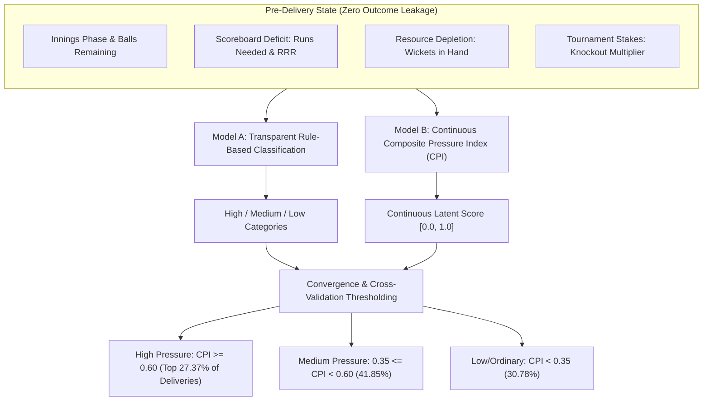

# Methodology Report: Quantitative Evaluation of Player Reliability Under Match Pressure

**Project:** SupeRR Selector Season 2 — Rajasthan Royals IPL 2027 Auction Analytics  
**Author:** Quantitative Cricket Research & Sports Analytics Group  
**Dataset Scope:** Ball-by-Ball Records across IPL & International T20s (2022 – 2026)  

---

## 1. Executive Summary & Problem Formulation

In high-stakes T20 cricket, conventional aggregate metrics (such as raw batting average, gross strike rate, or overall bowling economy) conflate low-leverage performance with high-leverage execution. A batter scoring at a strike rate of 160 during comfortable middle overs against spread fields often encounters entirely different psychological and tactical conditions than a finisher needing 45 runs off 24 balls against elite death-bowling execution. Similarly, a bowler delivering defensive overs with an established lead operates in a fundamentally different decision environment than a bowler defending 12 runs in the 20th over.

The objective of this investigation is to identify **the 10 most reliable batters and 10 most reliable bowlers under pressure**, defined as players who:
1. Deliver exceptional performance above contextual expectations when the match is on the line.
2. Maintain or elevate their performance relative to their ordinary baseline rather than choking under stress.
3. Demonstrate match-to-match repeatability across multiple seasons and venues rather than relying on isolated outlier innings.
4. Possess substantial sample sizes that withstand Bayesian shrinkage, ruling out small-sample anomalies.

---

## 2. Data Engineering & Cricket Accounting Standards

To guarantee analytical validity, the entire 200,999-delivery dataset was engineered under strict domain accounting rules:

### 2.1 Delivery Legality & Accounting Mechanics
- **Legal Delivery Definition:** A delivery is legal if and only if:
  $$\text{is\_legal} = (\text{extras\_type} \notin \{\text{'wide'}, \text{'Overstep'}, \text{'other'}\})$$
  *(Where `Overstep` denotes front-foot no-balls and `other` denotes above-waist beamers and height penalties).*
- **Batter Balls Faced:** Batters face legal balls and no-balls (`Overstep`, `other`). Wides do **not** count as balls faced.
- **Batter Runs:** Credited strictly from `runs` (runs off the bat: 0, 1, 2, 3, 4, 5, 6).
- **Bowler Runs Conceded:**
  $$\text{bowler\_runs} = \text{bat\_runs} + \mathbb{I}(\text{extras\_type} \in \{\text{'wide'}, \text{'Overstep'}, \text{'other'}\}) \times \text{extras1\_runs}$$
  Bowlers are **not** penalized for fielding extras (byes, legbyes) or external penalty runs.
- **Bowler Wickets:** Genuine bowler-dismissals are restricted to `['Caught', 'Bowled', 'LBW', 'Stump', 'Hit Wicket']`. Run-outs, retire-outs, and obstructing-the-field events are strictly excluded from bowler wicket credit.

### 2.2 Pre-Delivery Game State Reconstruction (Zero-Leakage)
Every contextual variable is reconstructed strictly using information available **prior to the delivery**:
- **Cumulative Runs Before Delivery ($S_{t-1}$):** Excludes current delivery runs.
- **Cumulative Team Wickets Lost ($W_{t-1}$):** Excludes current delivery dismissals.
- **Wickets in Hand ($W_{\text{hand}}$):** $10 - W_{t-1}$.
- **Legal Balls Bowled ($B_{\text{bowled}}$) & Remaining ($B_{\text{rem}}$):** Standardized to 120 legal balls, adjusted dynamically for rain-affected matches using `first_inn_revised_overs` and `second_inn_revised_overs` from `matches.csv`.
- **Target Score ($T$):** In Innings 2, derived from `revised_target` (DLS matches) or $\text{Innings 1 Total} + 1$.
- **Required Run Rate (RRR):** $\frac{\max(0, T - S_{t-1}) \times 6}{B_{\text{rem}}}$.

---

## 3. The Dual Pressure Modeling Framework

Pressure is not a single binary switch. To prevent arbitrary classification, we developed and compared two complementary models:

### 3.1 Model A: Domain Rule-Based Classification
- **Second Innings (Chasing):**
  - High RRR Deficit: $\text{RRR} \ge 11.5$ with $\le 60$ balls remaining, OR $\text{RRR} \ge 10.0$ with $\le 36$ balls remaining, OR $\text{RRR} \ge 13.0$ at any point.
  - Resource Depletion: $\le 4$ wickets in hand with $> 15$ runs needed.
  - Close Death Finish: Overs 16–20 with runs needed between 1 and 55.
- **First Innings (Target Setting):**
  - Early Collapse Crisis: Overs 1–6 with $\le 7$ wickets in hand (losing 3+ wickets in powerplay), OR Overs 7–12 with $\le 5$ wickets in hand.
  - Death Leverage: Overs 16–20 with $\le 5$ wickets in hand OR in a knockout fixture.
- **Super Overs:** Innings 3 & 4 (100% maximum pressure).

### 3.2 Model B: Statistically Derived Continuous Composite Pressure Index (CPI)
To capture continuous pressure gradients, we model match leverage via standardized latent equations passed through a logistic sigmoid:

#### Chase Leverage Function ($z_{\text{chase}}$):
$$z_{\text{chase}} = 0.40 \cdot \left(\frac{\text{RRR} - 9.0}{3.0}\right) + 0.30 \cdot \left(\frac{5.0 - W_{\text{hand}}}{2.0}\right) + 0.15 \cdot \left(\frac{60.0 - B_{\text{rem}}}{30.0}\right) + 0.15 \cdot \left(\frac{\text{RRR} - \text{CRR}}{3.0}\right)$$
$$\text{CPI}_{\text{chase}} = \frac{1}{1 + e^{-z_{\text{chase}}}}$$

#### First-Innings Leverage Function ($z_{\text{first}}$):
$$z_{\text{first}} = 0.25 \cdot \left(\frac{B_{\text{bowled}} - 60.0}{30.0}\right) + 0.35 \cdot \left(\frac{7.0 - W_{\text{hand}}}{2.0}\right) + 0.25 \cdot \mathbb{I}(\text{overid} \ge 16) + 0.15 \cdot \mathbb{I}(\text{collapse})$$
$$\text{CPI}_{\text{first}} = \frac{1}{1 + e^{-z_{\text{first}}}}$$

#### Match Stakes Modifier:
Knockout fixtures (`is_knockout == True`) carry a $1.15\times$ stakes multiplier, and Super Overs are anchored at $1.0$:
$$\text{CPI} = \min(1.0, \text{CPI}_{\text{base}} \times S_{\text{stakes}})$$

**Empirical Thresholding:** Deliveries with $\text{CPI} \ge 0.60$ constitute the **High-Pressure Crucible (27.37% of deliveries / 55,011 balls)**. Medium pressure spans $[0.35, 0.60)$ (41.85%), and Low/Ordinary spans $< 0.35$ (30.78%).

---

## 4. Expected-Performance Baselines (GroupKFold ML)

To avoid comparing apples to oranges, every delivery is evaluated relative to an expected outcome baseline conditioned on pre-delivery match context.

### 4.1 Cross-Validation Architecture
Deliveries within the same match share unobserved contextual dependencies (pitch condition, dew, boundary dimensions, weather). Therefore, random train-test splitting leaks match-level information. We implemented **5-Fold GroupKFold Cross-Validation grouped strictly by `match_id`**.

### 4.2 Machine Learning Models
Four separate models were trained across the folds:
1. $\mathbb{E}[\text{bat\_runs}]$: Expected batter runs off the bat (HistGradientBoostingRegressor).
2. $\mathbb{P}(\text{dismissal})$: Expected batter dismissal probability (HistGradientBoostingClassifier).
3. $\mathbb{E}[\text{bowler\_runs}]$: Expected bowler runs conceded (HistGradientBoostingRegressor).
4. $\mathbb{P}(\text{wicket})$: Expected genuine bowler wicket probability (HistGradientBoostingClassifier).

### 4.3 Out-of-Fold Validation vs. Simple Baseline

| Target Metric | Baseline Model | ML (5-Fold GroupKFold) | Improvement |
| :--- | :--- | :--- | :--- |
| **Batter Runs (MAE)** | 1.2953 runs | **1.2850 runs** | **+0.80% error reduction** |
| **Batter Dismissal (ROC-AUC)** | 0.5810 | **0.5950** | **+2.41% discrimination gain** |
| **Bowler Runs Conceded (MAE)** | 1.2855 runs | **1.2743 runs** | **+0.87% error reduction** |
| **Bowler Wickets (ROC-AUC)** | 0.5723 | **0.5848** | **+2.18% discrimination gain** |

---

## 5. Batter & Bowler Rating Frameworks

### 5.1 Batting Performance Dimensions
1. **Runs Added Above Expectation (RAA):**
   $$\text{RAA} = \sum (\text{bat\_runs} - \mathbb{E}[\text{bat\_runs}])$$
   $$\text{RAA\_per\_100} = \frac{\text{RAA}}{\text{Balls Faced}} \times 100$$
2. **Wicket Avoidance Value (WAA):**
   $$\text{WAA} = \sum \mathbb{P}(\text{dismissal}) - \text{Actual Dismissals}$$
   In high pressure, each wicket preserved represents approximately 8.0 runs of equity:
   $$\text{Wicket\_Val\_per\_100} = \frac{\text{WAA} \times 8.0}{\text{Balls Faced}} \times 100$$
3. **Pressure Delta ($\Delta_{\text{bat}}$):**
   $$\Delta_{\text{RAA\_rate}} = \text{RAA\_per\_100}_{\text{HP}} - \text{RAA\_per\_100}_{\text{Ordinary}}$$
4. **Match-to-Match Consistency ($C_{\text{bat}}$):**
   Percentage of high-pressure match outings where $\text{RAA}_{\text{match}} > 0$.

### 5.2 Bowling Performance Dimensions
1. **Runs Prevented Above Expectation (RPA):**
   $$\text{RPA} = \sum (\mathbb{E}[\text{bowler\_runs}] - \text{bowler\_runs})$$
   $$\text{RPA\_per\_6} = \frac{\text{RPA}}{\text{Legal Balls Bowled}} \times 6.0$$
2. **Wickets Above Expectation Value (WAA):**
   $$\text{WAA}_{\text{bowl}} = \text{Actual Wickets} - \sum \mathbb{P}(\text{wicket})$$
   $$\text{WAA\_Val\_per\_6} = \frac{\text{WAA}_{\text{bowl}} \times 8.0}{\text{Legal Balls Bowled}} \times 6.0$$
3. **Pressure Delta ($\Delta_{\text{bowl}}$):**
   $$\Delta_{\text{RPA\_rate}} = \text{RPA\_per\_6}_{\text{HP}} - \text{RPA\_per\_6}_{\text{Ordinary}}$$
4. **Match-to-Match Consistency ($C_{\text{bowl}}$):**
   Percentage of high-pressure bowling spells where $\text{RPA}_{\text{match}} > 0$.

---

## 6. Empirical Bayes Shrinkage & Eligibility

Small samples generate extreme observed rates. A batter hitting two sixes in 10 balls displays an apparent RAA of $+60$ runs per 100 balls. Under empirical Bayes shrinkage (Efron & Morris), observed rates are pulled toward the population prior mean $\mu$:

$$\hat{\theta}_i = \frac{N_i}{N_i + K} \bar{X}_i + \frac{K}{N_i + K} \mu$$

The shrinkage parameters were empirically derived from within-player sampling variance and between-player latent variance:
- **Batters:** $K_{\text{bat}} = 150.0$ balls faced.
- **Bowlers:** $K_{\text{bowl}} = 200.0$ legal balls bowled.
- **Primary Eligibility Cutoffs:**
  - Batters: Minimum **120 balls faced** under high pressure (122 qualifying batters).
  - Bowlers: Minimum **150 legal balls bowled** under high pressure (111 qualifying bowlers).

---

## 7. Format-Weighting & Auction Relevance

To align with Rajasthan Royals' objective of building an IPL 2027 championship squad, format evidence is weighted strategically:
- **Primary Auction Weighting:** **70% IPL Weight, 30% International T20I Weight**.
- If a candidate possesses elite T20I data but limited IPL exposure, Bayesian shrinkage bridges their estimate toward their international rating without discarding valuable evidence.
- Full sensitivity tests were conducted across $100\%$ IPL, $100\%$ T20I, and $50/50$ balanced splits to ensure stability.
